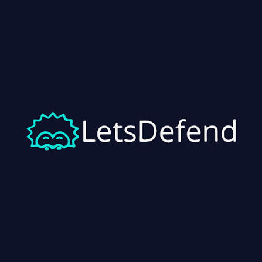

# Cybersecurity Learning Portfolio

This repository documents my hands-on cybersecurity learning: guided lab write-ups, pentest-style findings, SOC training notes, and Secure SDLC artifacts.

## What you'll find here
- Structured write-ups from TryHackMe, Hack The Box, LetsDefend, and PortSwigger Academy
- Practical notes on networking, Linux, Nmap, SOC operations, and web security
- Reproducible findings with clear steps to reproduce, fixes, and validation notes
## By Platform (pick a lab environment)

This section is intentionally short and scannable. Each platform has its own index README for details.

| Platform | Index | Featured |
|---|---|---|
|  **TryHackMe** | [writeups/tryhackme/](writeups/tryhackme/) | [Intermediate Nmap](writeups/tryhackme/Learning_Paths/Cyber_Security_101/M5-08-Intermediate_Nmap.md) · [Nmap: The Basics](writeups/tryhackme/Learning_Paths/Cyber_Security_101/M5-07-Nmap_The_Basics.md) · [tcpdump](writeups/tryhackme/Learning_Paths/Cyber_Security_101/M5-06-tcpdump.md) |
|  **Hack The Box** | [writeups/hackthebox/](writeups/hackthebox/) | [Preignition](writeups/hackthebox/Labs/Preignition/) · [Explosion](writeups/hackthebox/Labs/Explosion/) · [Redeemer](writeups/hackthebox/Labs/Redeemer/) |
|  **LetsDefend** | [writeups/letsdefend/](writeups/letsdefend/) | [SIEM and Analyst Relationship](writeups/letsdefend/SOC_Fundamentals/04-SIEM_and_Analyst_Relationship/) · [Introduction to SOC](writeups/letsdefend/SOC_Fundamentals/01-Introduction_to_SOC/) · [SOC Types and Roles](writeups/letsdefend/SOC_Fundamentals/02-SOC_Types_and_Roles/) |
|  **PortSwigger Web Security Academy** | [writeups/portswigger/](writeups/portswigger/) | [CSRF vulnerability with no defenses (change email)](writeups/portswigger/csrf/01-lab-csrf-change-email-no-token.md) · [SQL injection vulnerability in login function (PortSwigger)](writeups/portswigger/server-side-vulns/07-sql-injection/02-lab-sqli-login-bypass-administrator.md) · [SQL injection vulnerability in WHERE clause allowing retrieval of hidden data (PortSwigger)](writeups/portswigger/server-side-vulns/07-sql-injection/01-lab-sqli-where-clause-hidden-data.md) |
|  **OWASP Juice Shop** | _Planned_ | _Planned_ |

## Threat Models
- Threat model index: [threat-models/](threat-models/)

## CI/CD Security Demos
- Companion repo: https://github.com/efeberktnci/appsec-tools-demo

## Quick Start (Add a new write-up)
1. Open the relevant platform index under [writeups/](writeups/).
2. Add the completed lab or module in its platform folder:
   - [TryHackMe](writeups/tryhackme/)
   - [Hack The Box](writeups/hackthebox/)
   - [LetsDefend](writeups/letsdefend/)
   - [PortSwigger](writeups/portswigger/)
3. Remove sensitive values such as tokens, credentials, personal IP addresses, and private target URLs.
4. Use a clear commit message, for example: `writeup: add <lab name>`.

## Folder Structure
- [writeups/](writeups/) PortSwigger + other lab write-ups
- `reports/` Juice Shop reports and findings (Planned)
- [threat-models/](threat-models/) Threat model documents
- [checklists/](checklists/) Code review checklists
- [ci-cd-demo/](ci-cd-demo/) CI/CD security demo artifacts
- [templates/](templates/) Copy/paste templates

## Legal / Ethics
This repository is for labs and authorized targets only. No testing of real systems without explicit permission.
