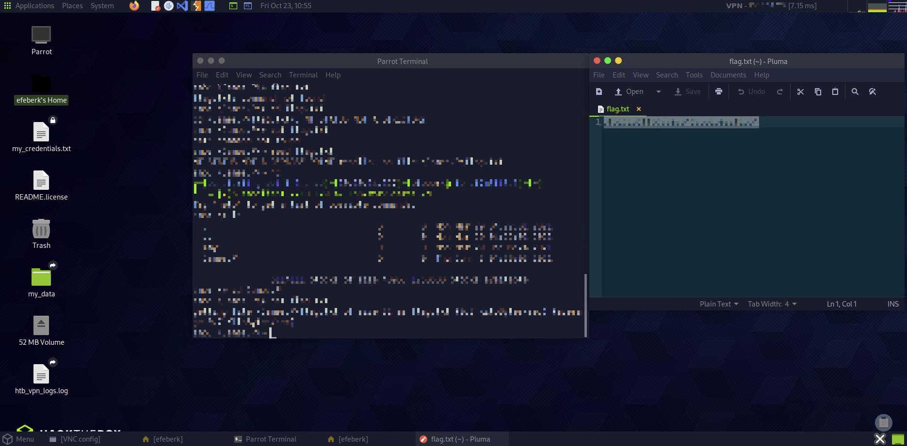

# Dancing

    

Lab link: [Dancing](https://app.hackthebox.com/starting-point)

## Completion proof

## Flag retrieval

## What I did

1. Connected to the Dancing target from Pwnbox and used `smbclient -L <target-ip>` to list its SMB shares.
2. Found four shares: `ADMIN$`, `C$`, `IPC$`, and `WorkShares`. The first two returned access denied; `IPC$` did not provide a browsable file listing.
3. Connected to the accessible file share with `smbclient //<target-ip>/WorkShares -N`.
4. Listed the share and found the `Amy.J` and `James.P` directories. Opened `James.P` and found `flag.txt`.
5. Downloaded the file with SMB client's `get` command, opened the local copy, and submitted the flag to complete the lab.

The flag value is intentionally omitted from this write-up.
