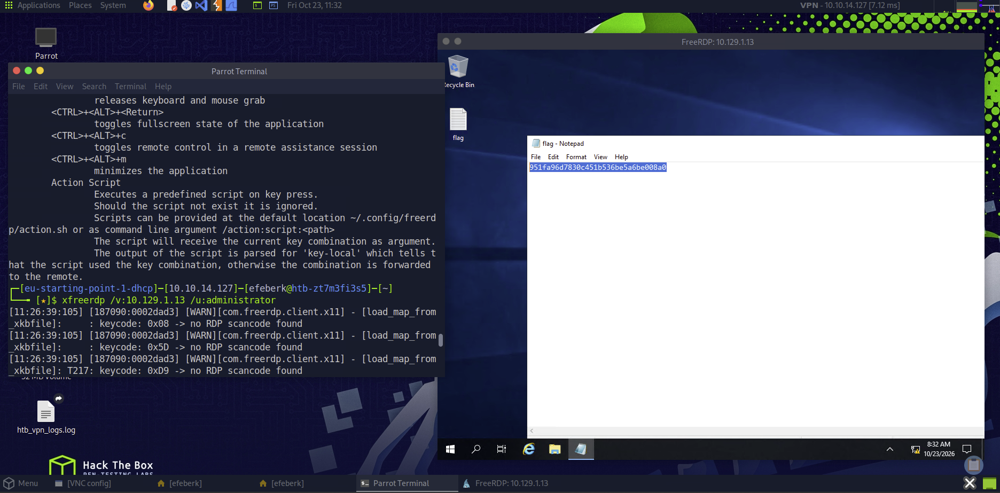

# Explosion

    

Lab link: [Explosion](https://app.hackthebox.com/starting-point)

## Completion proof

## Flag retrieval

## What I did

1. Connected to the Starting Point target from Pwnbox and identified the Remote Desktop service on `3389/tcp`.
2. Used `xfreerdp /v:<target-ip> /u:Administrator` to start an RDP session. The `/v:` option specifies the target host and `/u:` supplies the Windows username.
3. Left the password blank and reached the target's Windows desktop.
4. Opened the `flag` text file on the desktop and submitted its value to complete the lab.

The flag value is not transcribed in this write-up.
