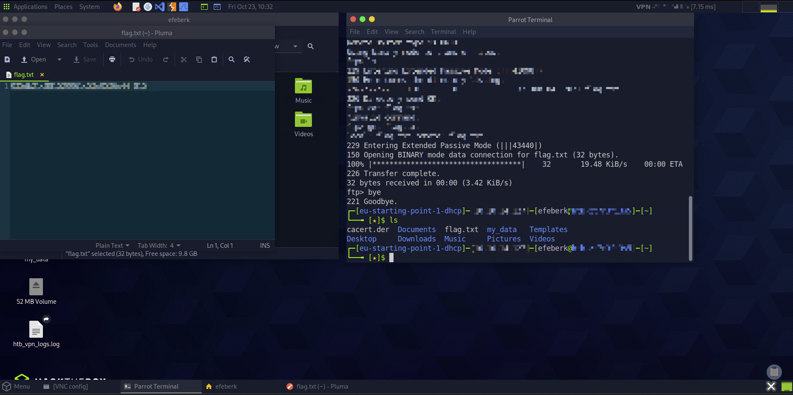

# Fawn

    

Lab link: [Fawn](https://app.hackthebox.com/starting-point)

## Completion proof

## Flag retrieval

## What I did

1. Connected to the Starting Point lab through Pwnbox and scanned the authorized target.
2. Identified FTP on port `21/tcp`, with the server reporting `vsFTPd 3.0.3`.
3. Connected with the FTP client and used the lab's account-free login to access the service.
4. Listed the remote directory, found `flag.txt`, and downloaded it with `get flag.txt`.
5. Left the FTP client and opened the downloaded file locally to complete the machine.

The flag value is intentionally omitted from this write-up.
