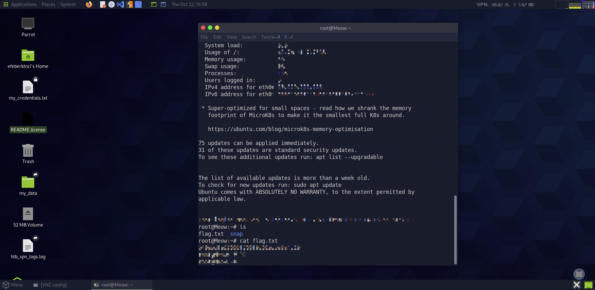

# Meow

    

Lab link: [Meow](https://app.hackthebox.com/starting-point)

## Completion proof

## Flag retrieval

## What I did

1. Scanned the authorized target to identify its reachable service.
2. Found Telnet exposed on port `23/tcp`.
3. Connected to the intentionally vulnerable lab service using the credentials indicated by the exercise.
4. Listed the root home directory and read the flag file to complete the machine.

The flag value is intentionally omitted from this write-up.
