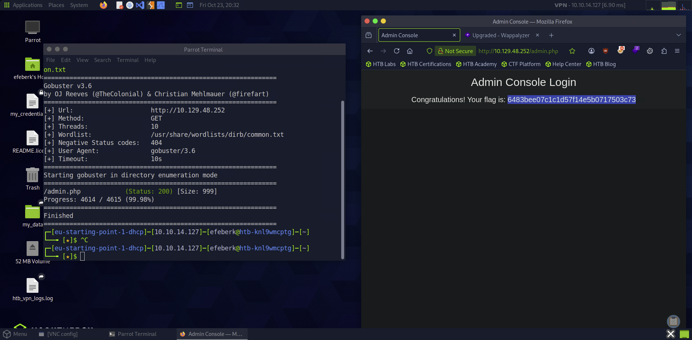

# Preignition

    

Lab link: [Preignition](https://app.hackthebox.com/starting-point)

## Completion proof

## Flag retrieval

## What I did

1. Connected to the target from Pwnbox and identified an HTTP service on `80/tcp`, served by `nginx 1.14.2`.
2. Enumerated web paths with `gobuster dir`, using the target URL and the local `/usr/share/wordlists/dirb/common.txt` wordlist.
3. Found `/admin.php` with HTTP status `200`. The chosen wordlist found the PHP page without adding a separate file-extension option.
4. Opened the discovered page in a browser and signed in to the Admin Console.
5. Read the flag displayed on the resulting page and submitted it to complete the lab.

The flag value is not transcribed in this write-up.
