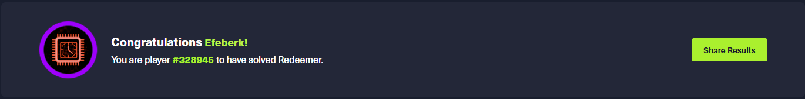
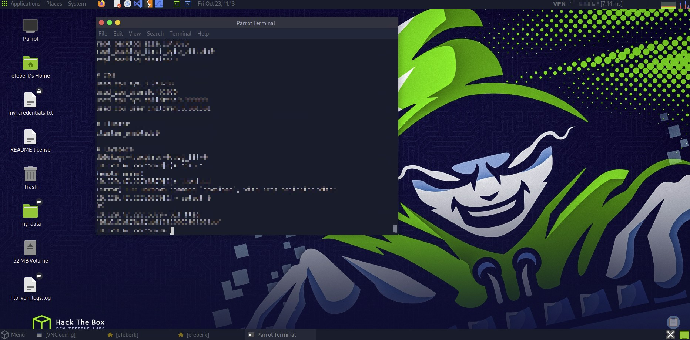

# Redeemer

   

Lab link: [Redeemer](https://app.hackthebox.com/starting-point)

## Completion proof

## Flag retrieval

## What I did

1. Scanned the target from Pwnbox with Nmap. The default scan covered the most common 1,000 TCP ports and showed no open port.
2. Scanned the full TCP port range with `nmap -p- <target-ip>` and found Redis on `6379/tcp`.
3. Connected to the service with `redis-cli -h <target-ip> -p 6379`.
4. Checked Redis information and saw `db0:keys=4` in the keyspace section. `KEYS *` listed four keys, including `flag`.
5. Briefly switched to database 1, where reading `flag` returned `(nil)`. The `1)` beside `flag` in the key list was its list position, not a database number.
6. Returned to database 0 with `SELECT 0` and read the value with `GET flag` to complete the lab.

The flag value is intentionally omitted from this write-up.
