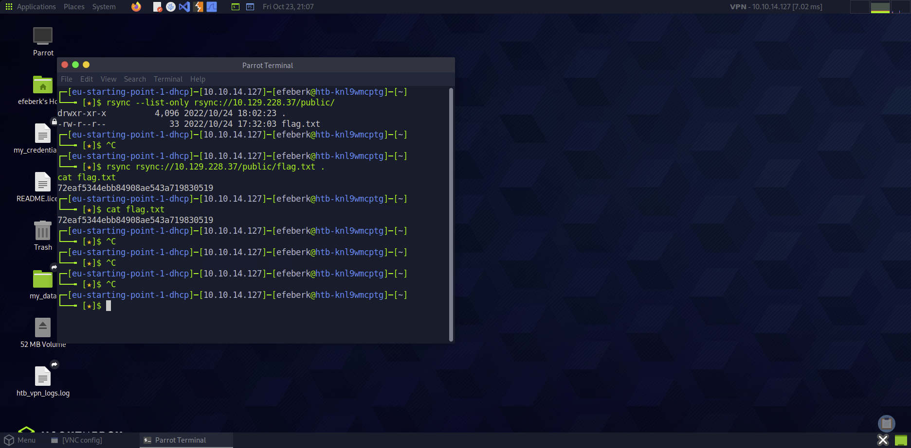

# Synced

    

Lab link: [Synced](https://app.hackthebox.com/starting-point)

## Completion proof


## Flag retrieval



## What I did

1. Listed the rsync daemon's available modules without supplying a username or password:

   ```bash
   rsync --list-only rsync://<target-ip>/
   ```

   The daemon exposed a module named `public`, described as an anonymous share. An rsync module is the named share that the daemon makes available to clients.

2. Listed the contents of that module without downloading anything:

   ```bash
   rsync --list-only rsync://<target-ip>/public/
   ```

   The listing showed `flag.txt` at the root of the share.

3. Copied that file into the current local directory and read it:

   ```bash
   rsync rsync://<target-ip>/public/flag.txt .
   cat flag.txt
   ```

4. Submitted the displayed flag to complete the lab.

The `--list-only` option enumerates available modules or files; the later `rsync` command performs the transfer. The flag value is not transcribed in this write-up.
