# Nmap: The Basics

Room link: https://tryhackme.com/room/nmap

## 1) Introduction and learning objectives
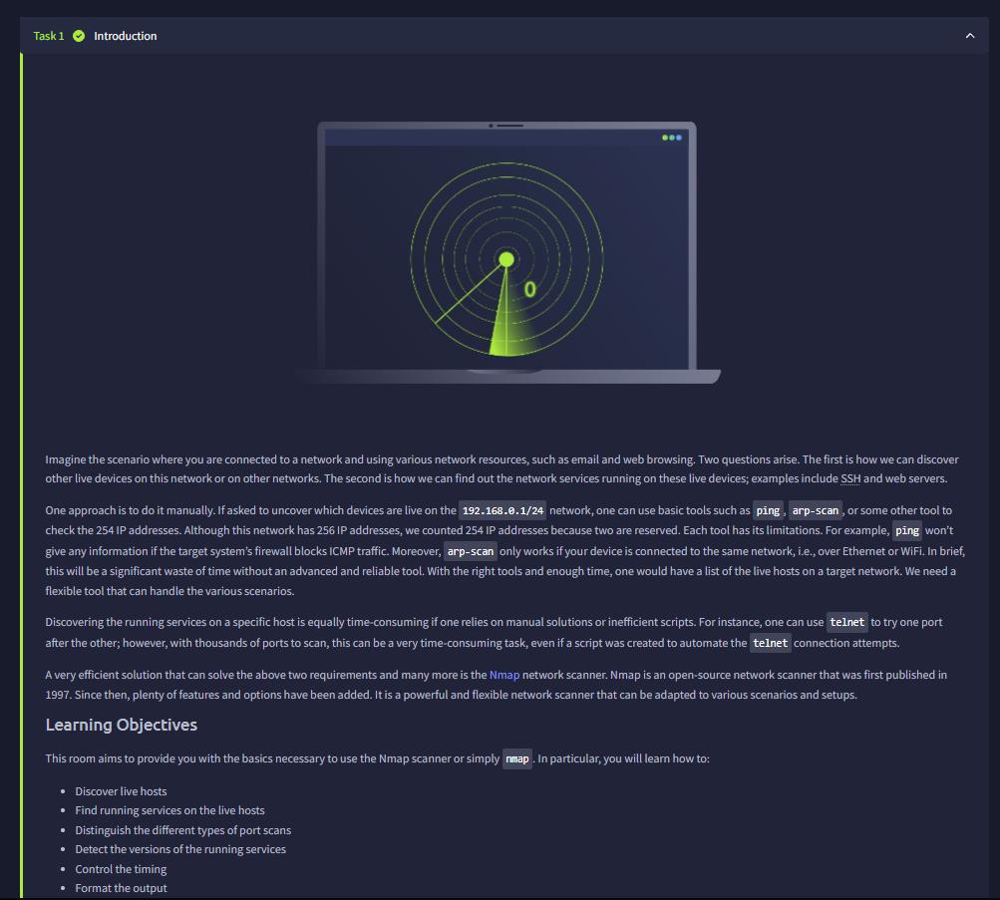

The introduction separates two questions: which hosts are online, and which services they expose. Nmap brings host discovery and port scanning into one workflow, followed by service identification, timing controls, and report output. The limitations of manual ping and telnet checks explain why a dedicated scanner is useful when working across many addresses or ports.

## 2) Target selection and local host discovery
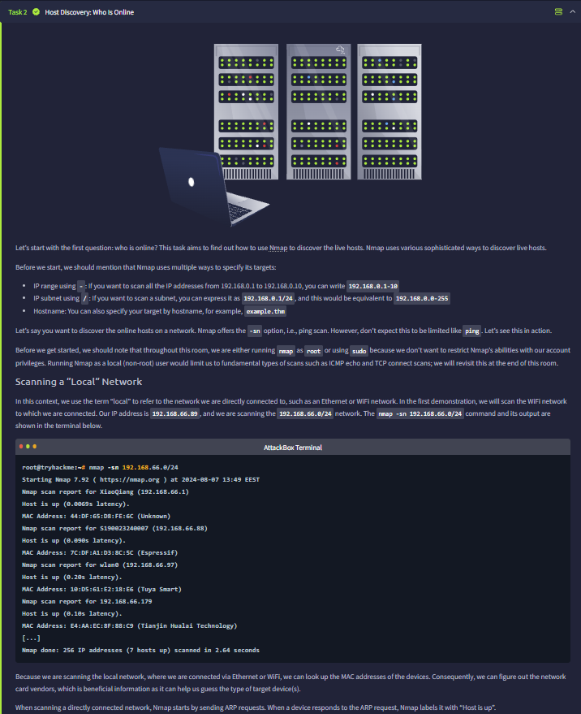

Targets can be supplied as an address range, a CIDR subnet, or a hostname. The example uses `-sn` to discover hosts without performing a port scan. On the directly connected Ethernet/WiFi network shown here, ARP responses identify live devices; the output also includes MAC addresses and vendor information. Discovering a host does not yet tell us which services it runs.

## 3) Host discovery across a routed network
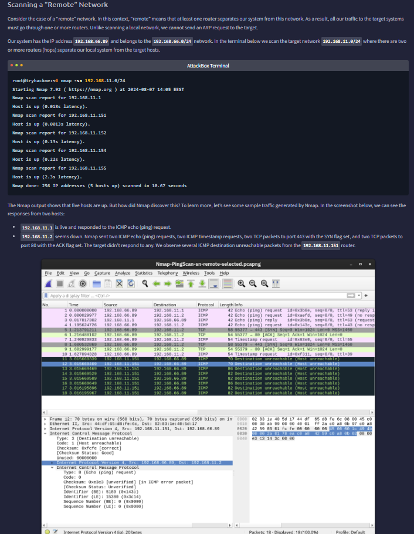

For a remote network, ARP cannot reach the target across routers. The lesson's capture instead shows ICMP and TCP discovery probes. One target answers an ICMP echo request, while probes to another receive host-unreachable messages from a router. These are different observations: a reply confirms responsiveness, while failed discovery alone does not establish that a machine is powered off.

## 4) Listing targets before scanning
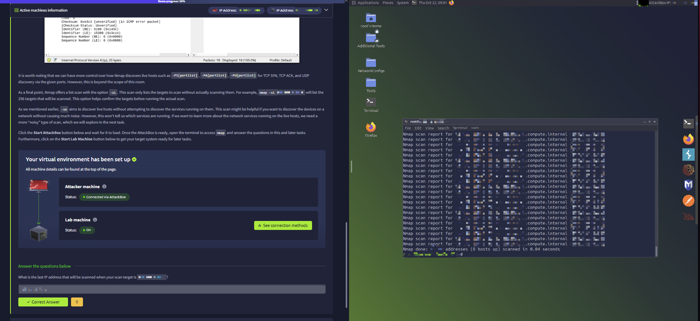

The `-sL` option lists the addresses included in the target specification without performing host discovery or a port scan. The terminal listing supports the exercise about the last address in the range. This is a useful scope check before scanning; the listing itself is not evidence that those hosts are online.

## 5) Port selection and the web-server exercise
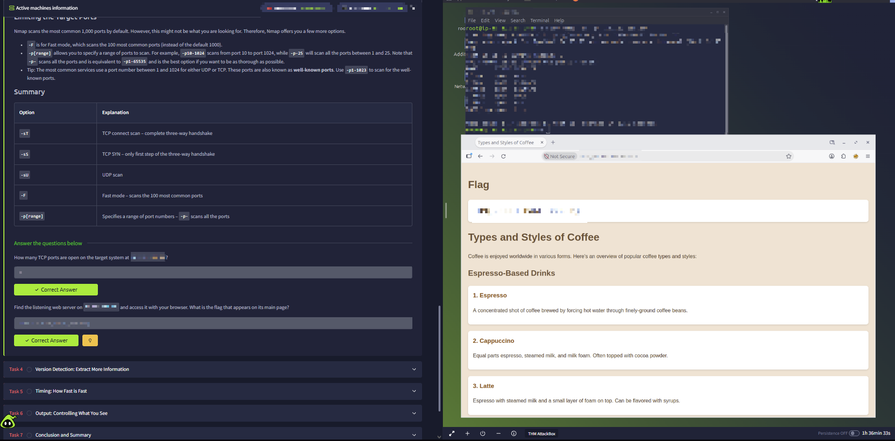

The table compares TCP connect (`-sT`), TCP SYN (`-sS`), and UDP (`-sU`) scans. A connect scan completes the TCP handshake, whereas a SYN scan checks the response without completing that connection. Port selection controls coverage: the default is the 1,000 most common ports for the selected protocol, `-F` reduces this to 100, and `-p` selects a range or specific ports; `-p-` covers ports 1 through 65535.

The practical screen shows accepted answers for the open TCP port count and the web-page flag, with the discovered website open in the browser. The target, port values, and flag are obscured, so the screenshot supports the workflow without exposing those exact values.

## 6) OS detection and service versions
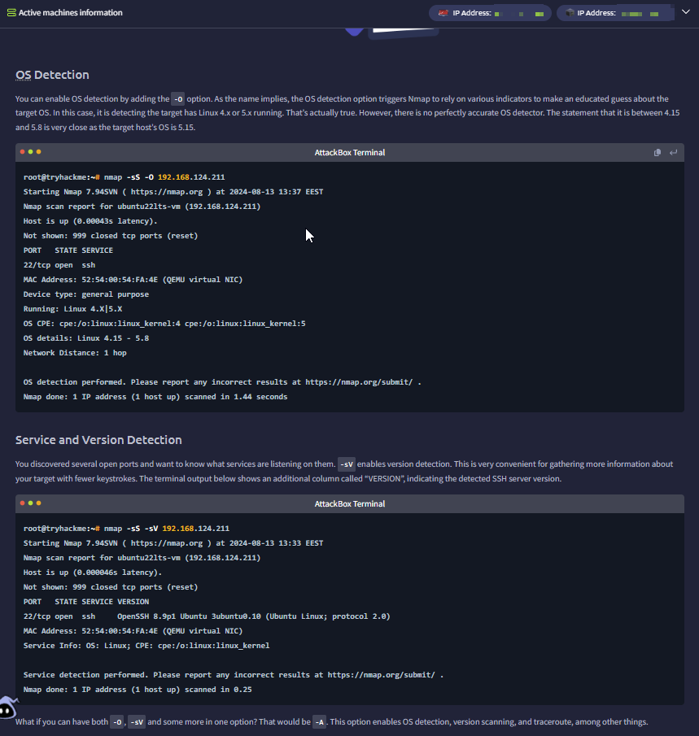

The lesson examples distinguish `-O`, which estimates the operating system from network responses, from `-sV`, which probes services for product and version information. The OS result gives a Linux kernel range, while the service result identifies an OpenSSH version on port 22. An OS fingerprint is an estimate rather than a guaranteed exact version. The combined `-A` option enables additional checks including OS detection, version detection, script scanning, and traceroute.

## 7) Skipping host discovery with -Pn
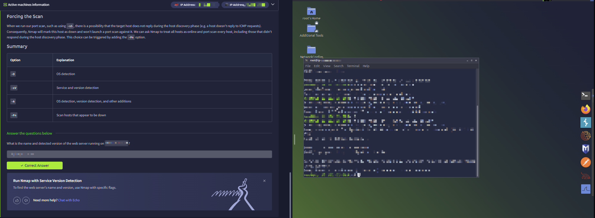

If a host does not answer discovery probes, Nmap may skip its port scan. `-Pn` tells Nmap to treat targets as online and proceed with the requested scan. It does not make a filtered port reachable; it changes the discovery decision. The accompanying exercise asks for the web server's name and detected version, and the answer is marked correct.

## 8) Timing templates and scan duration
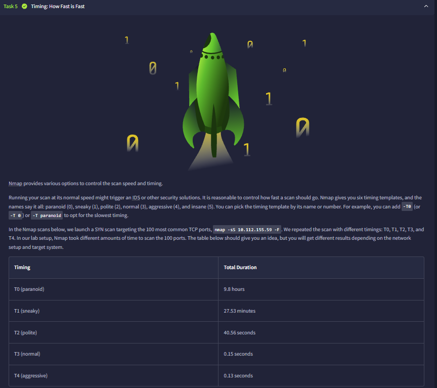

The timing templates range from `-T0` (paranoid) to `-T5` (insane), with `-T3` as the normal default. The table compares the duration of a 100-port SYN scan under several templates in the lesson's lab. Those durations belong to that setup: latency, packet loss, and the target's responses affect how quickly another scan finishes.

## 9) Comparing T0, T1, and T2 in packet captures
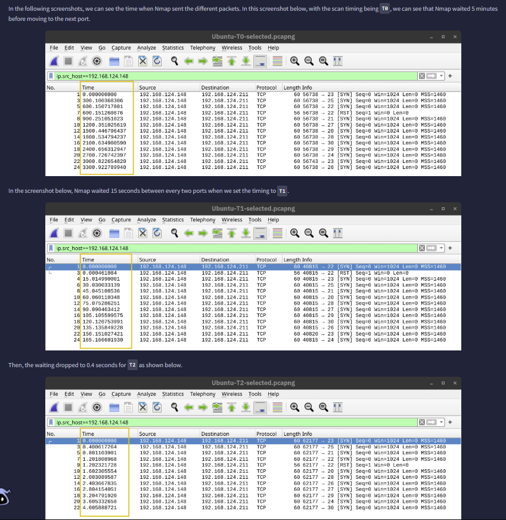

The Wireshark timestamps make the timing differences visible. In these examples, successive port probes are separated by roughly five minutes with T0, 15 seconds with T1, and 0.4 seconds with T2. Reading the packet times connects the command-line setting to the actual traffic generated.

## 10) Default timing, parallel probes, and rate limits
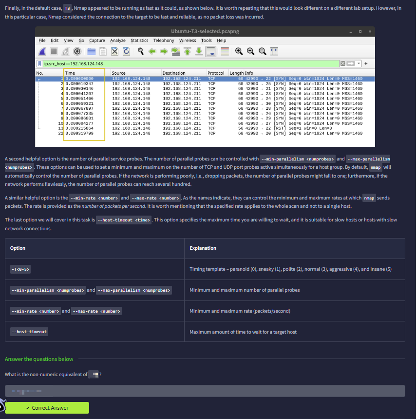

The T3 capture shows closely spaced probes on the lesson's fast, reliable connection. Below it, `--min-parallelism` and `--max-parallelism` control outstanding probes, while `--min-rate` and `--max-rate` set packet-rate bounds for the scan. `--host-timeout` limits the time spent on a target. These options control different aspects of scanning, so probe concurrency, packets per second, and total waiting time should not be treated as interchangeable.

## 11) Verbose output and debugging
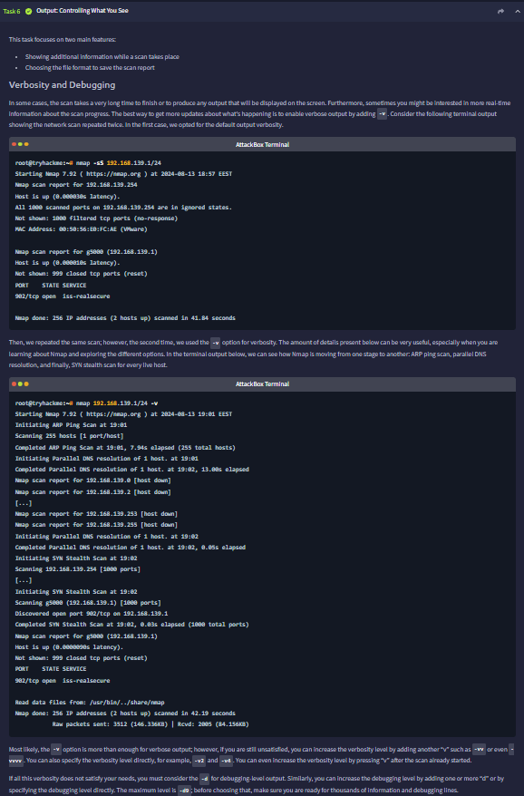

The first terminal example shows normal results; the second adds `-v` and exposes progress through discovery, DNS resolution, and the SYN scan. Higher verbosity adds detail about what Nmap is doing, while `-d` enables debugging output. These options help explain scan progress without changing the purpose of the selected scan.

## 12) Saving scan reports
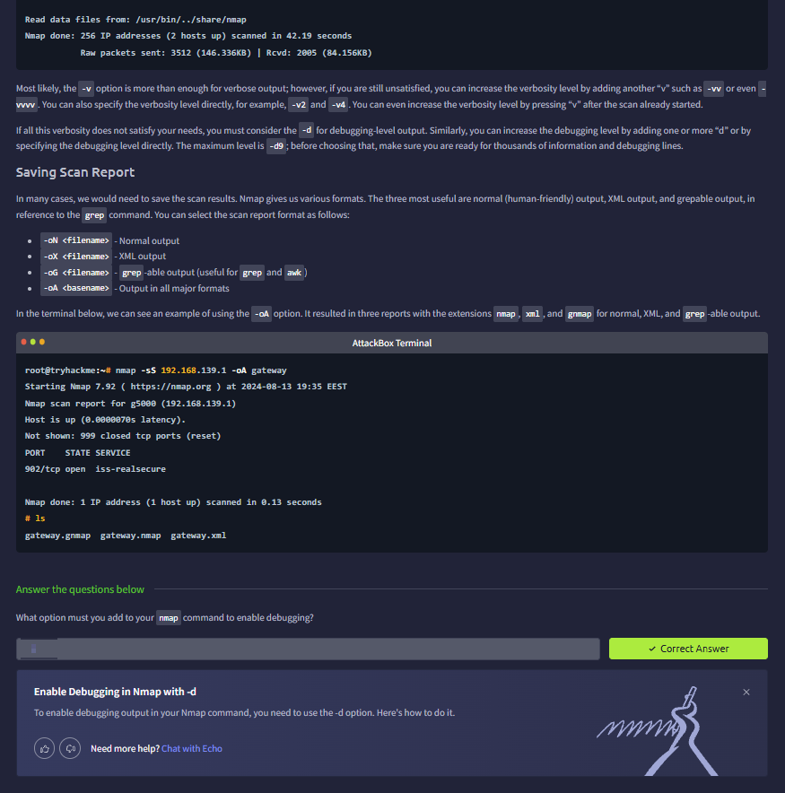

Nmap can save normal output with `-oN`, XML with `-oX`, and grepable output with `-oG`. The example uses `-oA gateway` and then lists `gateway.nmap`, `gateway.xml`, and `gateway.gnmap`. Saving the results preserves the scan evidence for later review and allows a suitable format to be selected for manual reading or processing.

## 13) Conclusion and option reference
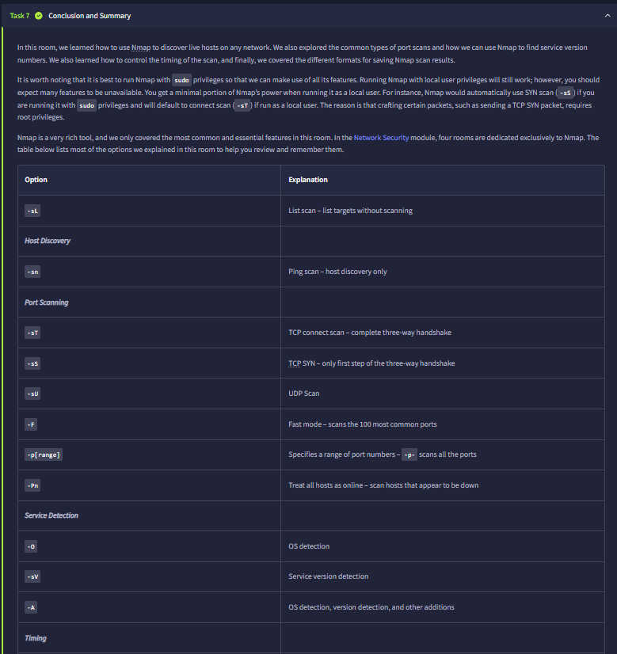

## 14) Option reference (continued) and final question
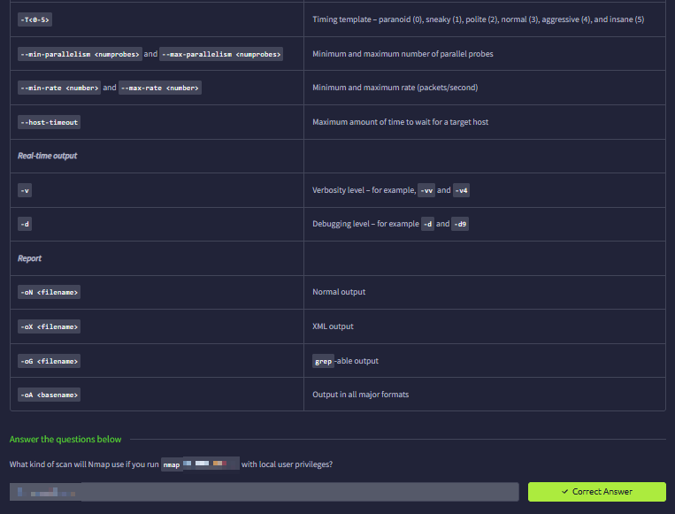
